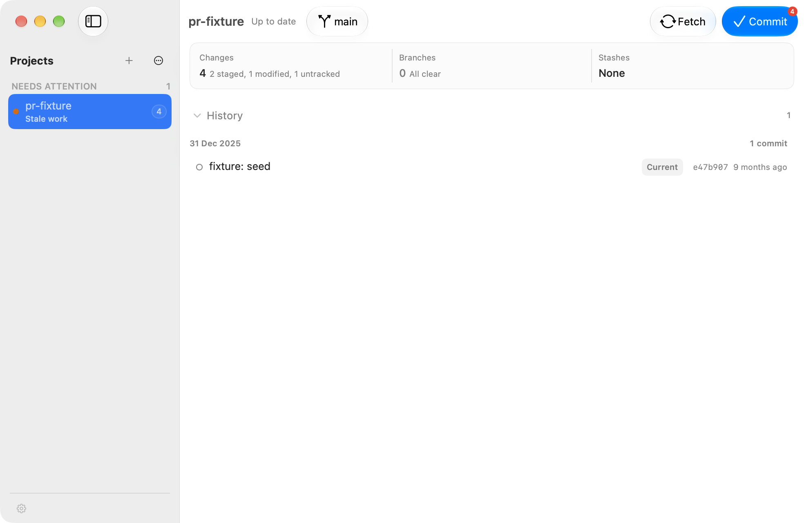
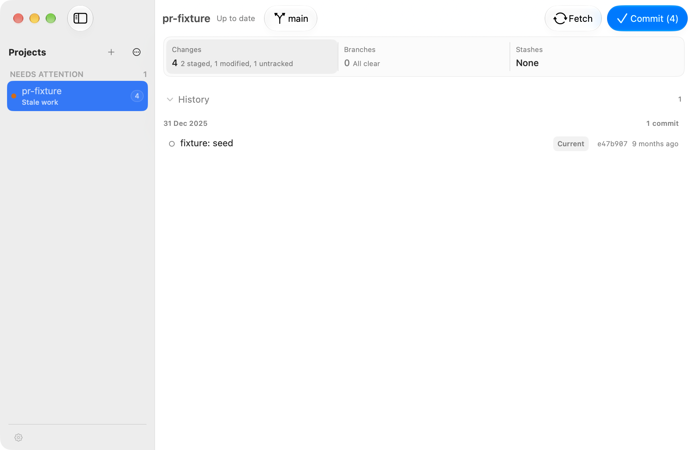
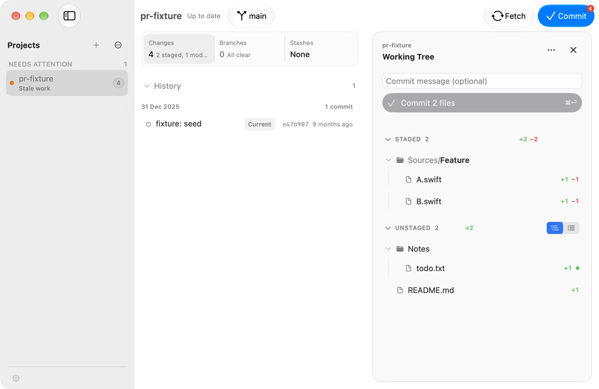
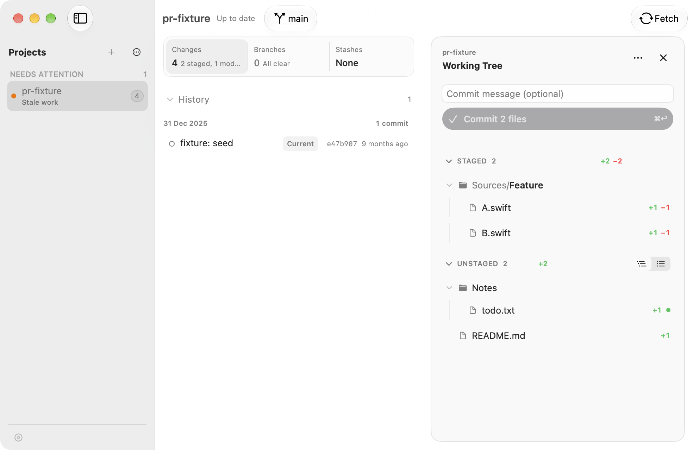

# Working Tree before and after

Visual evidence for issues #3–#5 and the partial accessibility audit in #6.

The before build is `5938c9af3efcd5fb180e1123b555e702b5a21993`.
The after build is `5c9605a469bbf5d8dd417129834d95e6e9079f18`.
Both use matching disposable repositories named `pr-fixture`: two staged
files, one modified file and one untracked file, with an empty commit message.
The captures use the same window size, light appearance, Tree mode and scroll
position. Each PNG is an unedited single-window capture at 1968 × 1280 pixels.

## Working Tree closed

The red notification badge becomes a count in the native prominent button's
title: `Commit (4)`. The button itself remains accent blue.

| Before | After |
| --- | --- |
|  |  |

## Working Tree open

The duplicate Commit action disappears from the toolbar while the panel is
open. The selected Tree segment becomes neutral rather than accent blue.
File names, counts and staging state match between the captures.

| Before | After |
| --- | --- |
|  |  |

## Validation limits

The Changes card has an incidental hover background in `after-toolbar.png`.
Static screenshots do not prove the stage/unstage motion in #3. There is no
matched Flat or dark appearance pair.

The #6 audit remains incomplete. Runtime testing found that Space and arrow
keys can remain in the commit message field after selecting a file, and that
Command-Return does not commit although Return does. These appear to be
baseline behavior, but were not reproduced on a baseline build. Dark
appearance, Reduce Motion, Reduce Transparency, Increase Contrast and several
batch/partial-staging and route-change scenarios remain unverified.

External file changes can also leave the selected repository's counts stale
until refresh. Static comparison traces this to unchanged baseline refresh
paths; it has not been reproduced on a baseline build. This PR does not fix
that independent synchronization defect.
