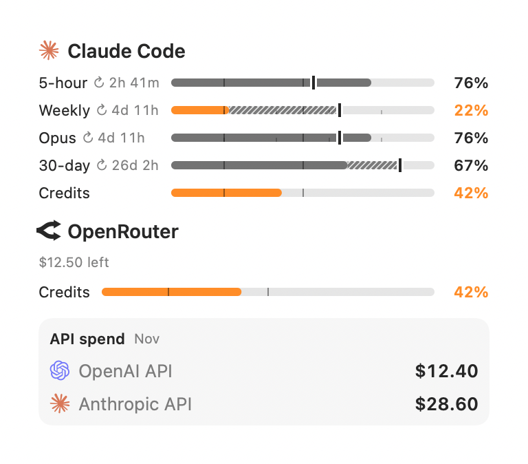
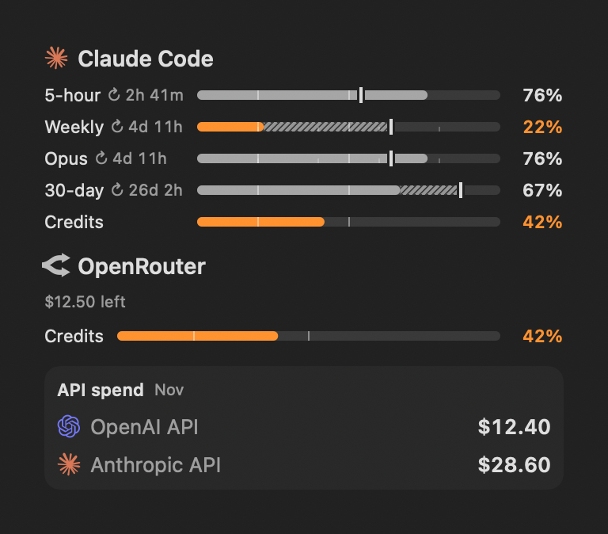
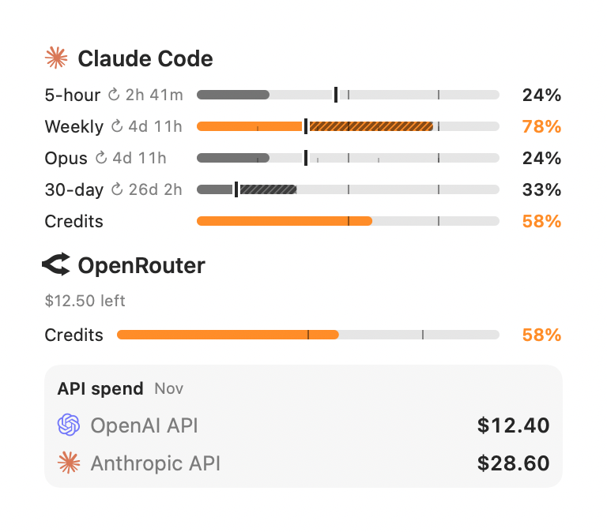
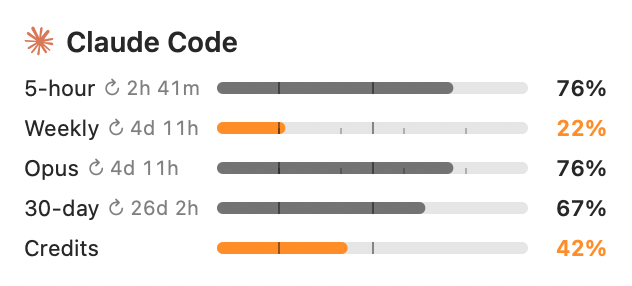
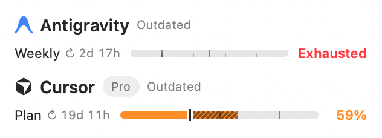
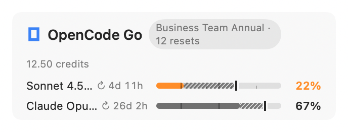
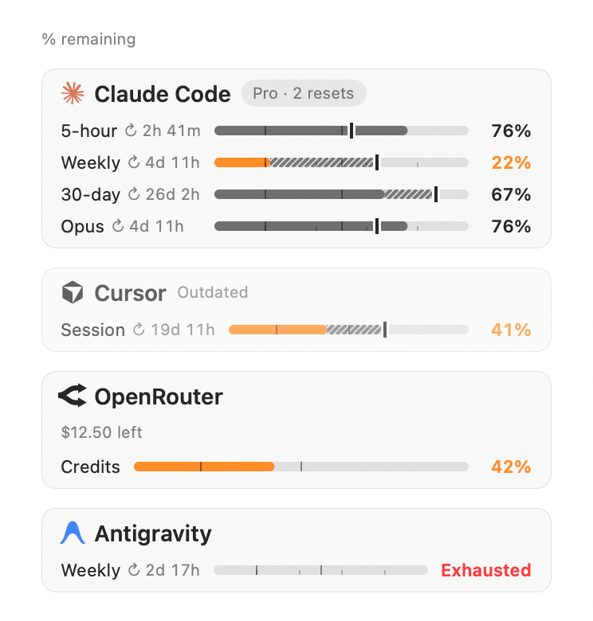
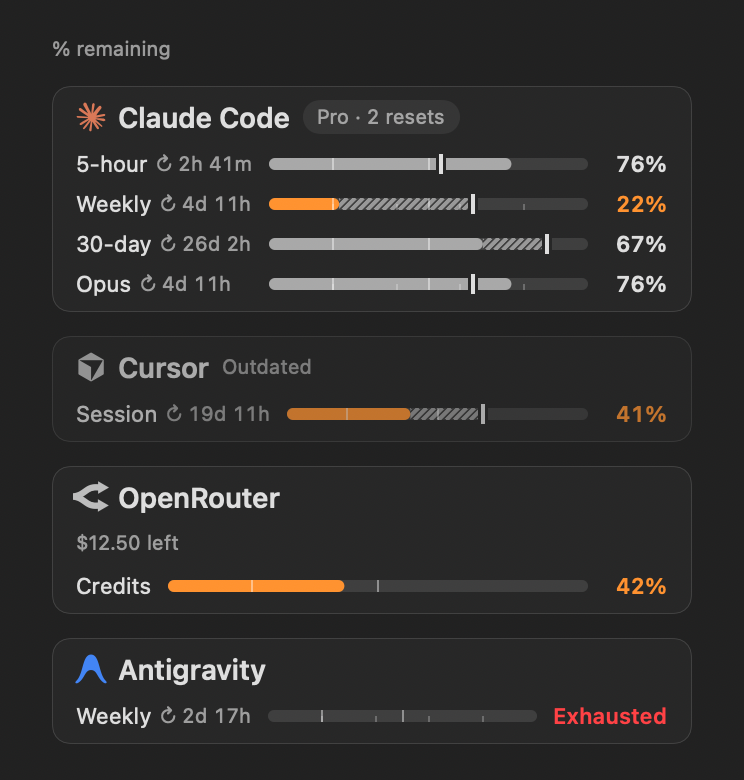
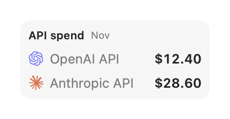

# Issue #19 — quota detail cards, reference vs implementation

Reference: [premium UI quotas mockup, rendered PNG][reference] and its
[HTML source][html] at `91c304ff57b51290f56ed19f6e82b9be57ff13a4`. The mockup
is a design proposal with fictional readings, not evidence of the app.

The captures below render the implemented `UsageQuotaLineCard` and
`UsageQuotaMenuView` through `ImageRenderer` at 2× with an isolated fixture
(the same one the issue names): 76% left against 54% expected (reserve), 22%
left against 64% expected (deficit), 67% left against 87% expected (30-day
deficit), a window without duration or reset, an exhausted weekly window, and a
stale snapshot. Provider icons are the app's real brand artwork. The capture
harness was temporary and is not part of the change; the committed images are
the rendered bytes.

## Implemented, light appearance

## Implemented, dark appearance

## Used percentage

## Pace hidden

## Exhausted weekly and stale snapshot

## Long window names at the menu width

## Menu surface

## API spend card

The footer popover uses the same `UsageQuotaLineCard` at its 340 pt width and
adds the same once-per-surface legend. It is not captured separately because
`ImageRenderer` returns no image for the popover's `ScrollView`; the shared card
and the menu render above cover the states. The popover also has a preview in
`UsageQuotaStripView.swift`.

## Differences from the reference

| Reference | Implementation | Kind |
| --- | --- | --- |
| Surface caption `% remaining · updated 2m ago` | `% remaining` once per surface; the submenu keeps its existing separate `Updated …` item, and the popover has no updated line | Intentional: the updated line is not part of this unit |
| Fictional provider glyphs | Real `ProviderIconView` artwork | Intentional (required) |
| Claude rows: session, weekly, model | Session, weekly, monthly, model windows (the fixture has both a 30-day and a model window) | Intentional: existing window order is preserved |
| `Model only` placeholder | The window's real label (`Opus`) | Intentional: real provider labels |
| Orange hatch stripes | Neutral primary hatch stripes | Intentional: stays visible over an orange alert fill in Used mode, and the pattern, not color, is the deficit signal |
| Visible legend for marker and hatch | Marker and deficit explained in each row's tooltip and VoiceOver value | Intentional: the issue allows no second number/text band per row |
| `OpenAI` / `Anthropic` cost row titles | `OpenAI API` / `Anthropic API`, the existing cost model titles | Intentional |
| Fixed mockup metrics from CSS | `WorkbenchMetrics` / `WorkbenchTypography` / `WorkbenchPalette` values | Intentional (required) |
| Countdown `2h 42m`, `4d 11h`, `26d 2h` | `2h 41m`, `4d 11h`, `26d 2h` | Matching difference: the fixture places resets relative to render time, so the first second of elapsed time floors one countdown by a minute |
| 5-segment dots | Continuous bar | Intentional: the issue replaces dots |

No appearance defect is known at these widths. The exhausted row shows an empty
track with discrete ticks because the reading is 0%; its value reads
`Exhausted` and its VoiceOver value says `quota exhausted`, so the state never
depends on a fill color.

## Proven

- `make build` succeeds on the branch.
- `make test-focused TEST_FILTER='GitMenuBarTests/UsageQuotaLineCardTests'`,
  `…/UsageQuotaPaceTests`, `…/UsageQuotaFormattingTests`, and
  `…/UsageQuotaCostEstimateTests` pass. The numeric oracles cover the fill
  (22/78), the expected marker (64/36), and the hatch ranges (22–64 and 36–78),
  reserve and on-track omissions, hidden pace, clamping, reset text, and the
  row/header accessibility strings.
- `make check-preview` passes for the changed UI files.

## Pending

- VoiceOver was checked through the unit-tested strings, not with a screen
  reader session.
- Increase Contrast and Reduce Transparency are system settings that
  `ImageRenderer` cannot override. The affected code uses
  `WorkbenchPalette.neutralBorder(contrast:)` for the track and raises the
  hatch opacity when contrast is increased; the cards use no materials, so
  Reduce Transparency does not change them. The increased-contrast branch has
  no capture.
- The captures render the SwiftUI surfaces, not the live `NSMenu` hosting
  view; the menu item, refresh action, and real provider ordering are unchanged
  and covered by the existing tests.

[reference]: https://raw.githubusercontent.com/mourato/GitMenuBar/91c304ff57b51290f56ed19f6e82b9be57ff13a4/docs/design/premium-ui-2026-11-13/quotas.png
[html]: https://github.com/mourato/GitMenuBar/blob/91c304ff57b51290f56ed19f6e82b9be57ff13a4/docs/design/premium-ui-2026-11-13/quotas.html
