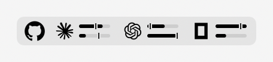
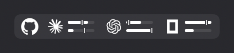
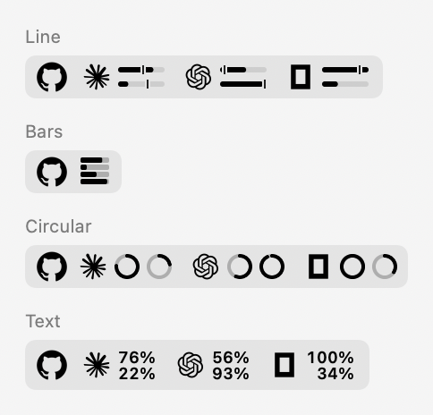
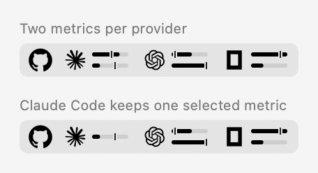
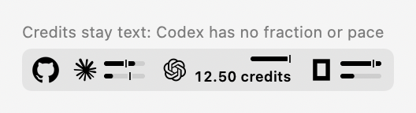
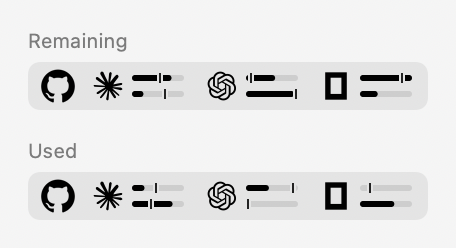
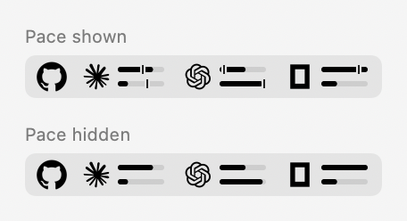
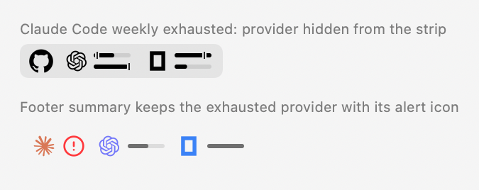
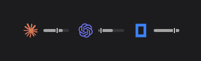
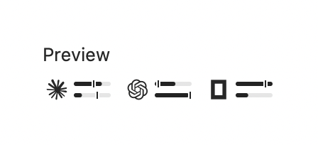

# Issue #20 — Line style in the menu bar, reference vs implementation

Reference: [premium UI menu-bar mockup][reference] and its [HTML source][html]
at `91c304ff57b51290f56ed19f6e82b9be57ff13a4`. The mockup is a design proposal
with fictional readings, not evidence of the app.

The captures below render the implemented `UsageQuotaMenuBarStrip`,
`UsageQuotaSummaryView`, and the real `StatusItemBadgeRenderer` composite
through `ImageRenderer` at 2× with an isolated fixture: Claude Code at 76% left
against 54% expected (reserve) and 22% left against 64% expected (deficit),
Codex at 56% against 9% and 93% against 97%, OpenCode Go at 100% and 34% on
pace, plus `12.50 credits` for the textual case. The capture harness was
temporary and is not part of the change; the committed images are the rendered
bytes.

Provider icons in the strip are the app's real brand artwork, rendered as a
template so the menu bar's own appearance sets the ink. The composite captures
reuse `StatusItemBadgeRenderer.makeCompositeImage`, so the GitBar icon and the
quota strip are exactly the two images the status item combines.

## Status item, Line, light appearance

## Status item, Line, dark appearance

## Every compact style with the same data

Titles above each strip are capture annotations, not interface.

## One and two selected metrics

## Credits stay textual

## Remaining and Used

## Pace shown and hidden

## Exhausted weekly

The status item hides a provider whose weekly window is exhausted, as before.
The footer summary is not part of that policy and keeps the provider with its
existing alert icon; the critical-window policy is the next issue.

## Footer summary, Line

The footer summary reads the clock itself, so its fixture is anchored to the
capture time. The status-item fixtures use a fixed date.

## Settings preview

The full Settings form is not captured: `ImageRenderer` returns no image for
the AppKit-backed grouped `Form`. The preview row above is the surface the
Settings section renders, and the section keeps its Xcode preview in
`UsageQuotaSettingsSection.swift`.

## Differences from the reference

| Reference | Implementation | Kind |
| --- | --- | --- |
| Two providers in the menu-bar image | Every eligible provider, two readings each | Intentional: existing strip behavior |
| Two stacked bars per provider everywhere | The status item shows up to two readings; the footer summary keeps its existing single primary window | Matching: the footer summary has always shown one figure per provider |
| Fictional monochrome glyphs | Real `ProviderIconView` artwork as a template | Intentional (required) |
| Orange warning fill in the menu bar | One template ink; no warning color | Intentional: the status item is a template image, and the reading's value and VoiceOver text carry the warning |
| Diagonal hatch inside the compact deficit | No hatch at menu-bar size | Intentional: the issue forbids hatch that stops being legible; the pace marker stays |
| Marker drawn taller than the 3 pt bar with an overhang | Marker fills the 5 pt token height with a 3 pt halo cut | Intentional: keeps the marker inside the image without clipping |
| Fixed CSS bar width (26 px) | `WorkbenchMetrics.quotaMeterCompactWidth` (26 pt) and `quotaMeterCompactHeight` (3 pt) | Intentional (required) |
| Two percentages in the Text style | Existing Text behavior, unchanged | Matching |
| Visible legend under the mockup | None in the strip; the marker is explained in the detail cards | Intentional: the legend is a reference annotation |
| `Model only` placeholder | The window's real label and its own pace | Intentional: existing model-window fallback |
| Credits not shown in the menu bar | Selected credit/reset figures stay text beside the bars | Intentional: required by the issue |
| Segmented style picker always available | The picker keeps its existing disabled state in Menu only | Intentional: `Always` / `Menu only` behavior is unchanged by this unit |

No appearance defect is known at these sizes. The compact bar keeps the
once-per-surface Remaining/Used direction from the value style; the pace marker
mirrors with it, and a reading with no proportion never draws a bar.

## Proven

- `make build` succeeds on the branch.
- `make check-preview` passes for the changed UI files (6 candidates), including
  the new `UsageQuotaMenuBarStrip` through its same-directory preview.
- `make test-focused TEST_FILTER='GitMenuBarTests/UsageQuotaPresentationPreferencesTests'`
  passes: absent and unknown raw values fall back to Line, every saved raw value
  (Line, Bars, Circular, Text) keeps its choice, a fresh instance writes no
  style default, and the raw values did not change.
- `make test-focused TEST_FILTER='GitMenuBarTests/UsageQuotaMenuBarGroupTests'`
  passes: groups carry fill and pace from the matching window, Used mirrors both
  fill and marker, credits stay textual, the pace preference hides markers, the
  model-window fallback keeps its own pace, exhausted weekly still hides the
  provider, and model-only providers still appear.
- `make test-focused TEST_FILTER='GitMenuBarTests/UsageQuotaLineCardTests'`
  passes: the card meter and its accessibility strings are unchanged.
- Scoped `scripts/lint.sh` over every touched Swift file reports zero
  violations.
- `make guidance-check` and `make lint` only fail on the issues already
  documented in #33 and #32 respectively; the touched files add none.

## Pending

- The full `make test` gate reached 832 passing tests with zero failures and
  then stopped progressing in the pre-existing GitHub/AI-commit test classes;
  later test sessions stalled at launch behind a pending macOS authorization
  dialog on this machine. The focused suites above are the test evidence for
  this unit; re-run the full gate on a clean machine before integrating.
- The captures render the SwiftUI strip and the real composite renderer, not a
  screenshot of a live menu bar. The status item, its tooltip, the submenu,
  Refresh, and provider ordering use the existing code paths and tests.
- Restart-with-saved-preference and the light/dark switch are proven by the
  preference and rendering tests, not by a session recording.
- Increase Contrast and Reduce Transparency cannot be forced through
  `ImageRenderer`. The compact strip draws no material, uses the token border
  for the track and the marker's halo for contrast, so neither setting changes
  its geometry; the increased-contrast branch has no capture.
- VoiceOver was checked through the status item's accessibility label and
  description, built from the same provider/value strings as before, not with a
  screen-reader session.

[reference]: https://raw.githubusercontent.com/mourato/GitMenuBar/91c304ff57b51290f56ed19f6e82b9be57ff13a4/docs/design/premium-ui-2026-11-13/menubar.png
[html]: https://github.com/mourato/GitMenuBar/blob/91c304ff57b51290f56ed19f6e82b9be57ff13a4/docs/design/premium-ui-2026-11-13/menubar.html
