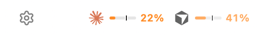
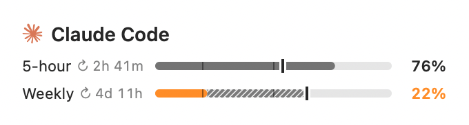

# Issue #21 — Critical window in the sidebar footer

Reference: [premium UI footer mockup][reference] and its [HTML source][html]
at `91c304ff57b51290f56ed19f6e82b9be57ff13a4` (the issue body links carry a
missing slash before `docs/`; the paths here are the corrected ones). The
mockup is a design proposal with fictional readings, not evidence of the app.

The captures below render the implemented `UsageQuotaSummaryView` through
`ImageRenderer` at 2× with an isolated fixture: Claude Code at Session 76%
against Weekly 22% (the issue's mandatory case), Cursor stale at 41%, an
exhausted Antigravity weekly window, OpenRouter credits at 42%, plus a second
set with a monthly critical window (15%), a tied Session/Weekly pair (20%
each), and a critical model window (12%). Provider icons are the app's real
brand artwork. The capture harness was temporary and is not part of the
change; the committed images are the rendered bytes.

## Footer summary, Line, light appearance

The footer shows Weekly 22%, not Session 76%. The tooltip and VoiceOver name
the same window: `Claude Code, Weekly, 22% left, 42% in deficit, Runs out in
16m`; the stale provider appends `Outdated`; the exhausted one reads
`Antigravity, Weekly, quota exhausted`.

## Footer summary, Line, dark appearance

## Footer summary, Used style

The choice of window does not change between Remaining and Used; only the
number mirrors (22% ↔ 78%). `Exhausted` stays literal, never `100% used`.

## Every meter style with the same critical window

## Monthly, tie, and model states

The tied Session/Weekly pair at 20% resolves to Session (declared order);
the critical model window keeps its own label.

## Composed footer at the minimum sidebar width

The Settings control keeps its size and the project names are untouched; no
window metric changed.

## Detail cards behind the popover

Clicking the footer opens the popover with both rows, so the footer figure
confirms the same window and value (Session 76% first, Weekly 22% below it).

## Differences from the reference

| Reference | Implementation | Kind |
| --- | --- | --- |
| Two sidebar glyphs (`▲`, `✳`) in monochrome | Real `ProviderIconView` artwork | Intentional (required) |
| 22 px CSS bar with a bare marker | `WorkbenchMetrics.quotaMeterCompactWidth` (26 pt) compact `UsageQuotaLineMeter` with its pace marker | Intentional (required) |
| Bare number after the bar | Monospaced `captionStrong` percent (`22%`, `78%` used), `Exhausted` with the alert icon and no bar when weekly is exhausted | Intentional: the issue requires the explicit number and the specific exhausted signal |
| Tooltip names the displayed window | Tooltip and VoiceOver share one string built from the resolved window (`Claude Code, Weekly, 22% left, …`) | Matching: no permanent legend added |
| One footer state | Critical weekly, critical session, quiet fallback, monthly, model, tie, exhausted, stale, Used, all four meter styles, and the composed 256 pt footer | Intentional: the issue lists every state |
| Space for three providers at 340 px | Three providers fit at wider widths; at the 256 pt minimum the trailing provider clips while Settings and the list names keep their size | Known limitation, see Pending |

## Proven

- `make build` succeeds on the branch.
- `make check-preview` passes for the changed UI files.
- `make test-focused TEST_FILTER='GitMenuBarTests/UsageQuotaSummaryResolutionTests'`
  passes: 18 tests covering the mandatory acceptance cases with independent
  numeric oracles (Session 76 vs Weekly 22 → Weekly; Session 10 vs Weekly 22
  → Session; quiet fallback; empty thresholds; monthly/model critical
  windows; tie order; per-window thresholds; exhausted precedence; snapshot
  without windows; Used/Remaining invariance) plus the shared
  tooltip/VoiceOver strings (provider, window, value, pace, `Outdated`,
  exhausted reading, no Session named with a Weekly value).
- `make test-focused` on `UsageQuotaLineCardTests`,
  `UsageQuotaFormattingTests`, `UsageQuotaPaceTests`,
  `UsageQuotaPresentationPreferencesTests`, and `UsageQuotaMenuBarGroupTests`
  passes: cards, thresholds, pace, preferences, and the menu-bar strip (which
  keeps its own user-chosen metrics) are unchanged.
- Scoped `scripts/lint.sh` over every touched Swift file reports zero
  violations; `git diff --check` is clean.
- `make guidance-check` and `make lint` only fail on the issues already
  documented in #33 and #32 respectively; the touched files add none.

## Pending

- VoiceOver was checked through the unit-tested strings, not with a screen
  reader session. Hover tooltips render the same string; no hover capture
  exists because `ImageRenderer` cannot capture hover.
- Increase Contrast and Reduce Transparency cannot be forced through
  `ImageRenderer`. The footer track uses the contrast-aware
  `WorkbenchPalette.neutralBorder(contrast:)`; the increased-contrast branch
  has no capture.
- At the 256 pt minimum with three quota providers, the trailing provider
  clips at the sidebar edge ([capture](footer-min-width-3up-composed-light.png)):
  the Settings control, the project names, and the window width are
  unaffected, and widening the user-resizable sidebar reveals all three. No
  fix is proposed in this unit: every density (bar, marker, number) the issue
  requires cannot fit three providers in 196 pt without dropping one of them.
- The full `make test` gate passes on the branch: 913 tests, 0 failures.

[reference]: https://raw.githubusercontent.com/mourato/GitMenuBar/91c304ff57b51290f56ed19f6e82b9be57ff13a4/docs/design/premium-ui-2026-11-13/footer.png
[html]: https://github.com/mourato/GitMenuBar/blob/91c304ff57b51290f56ed19f6e82b9be57ff13a4/docs/design/premium-ui-2026-11-13/footer.html
